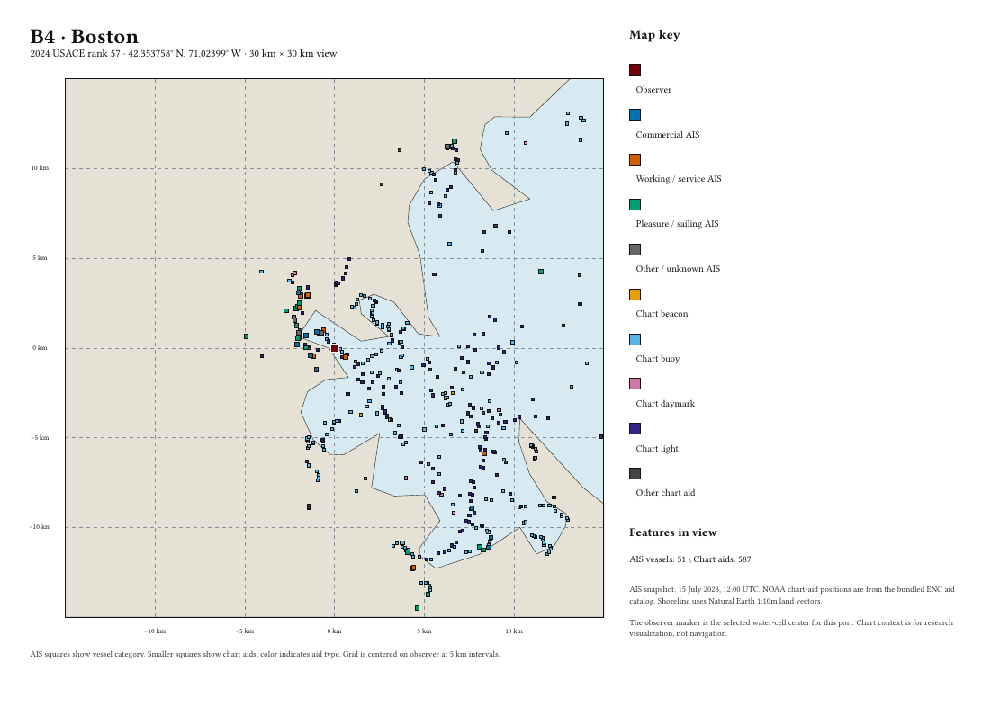
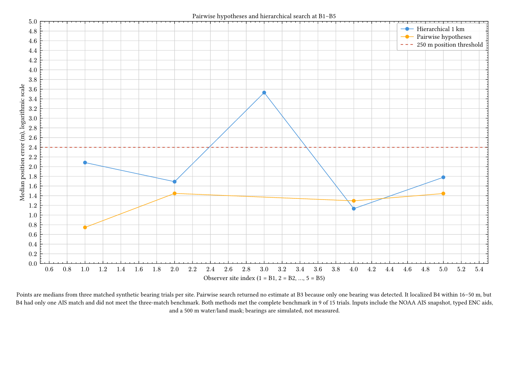
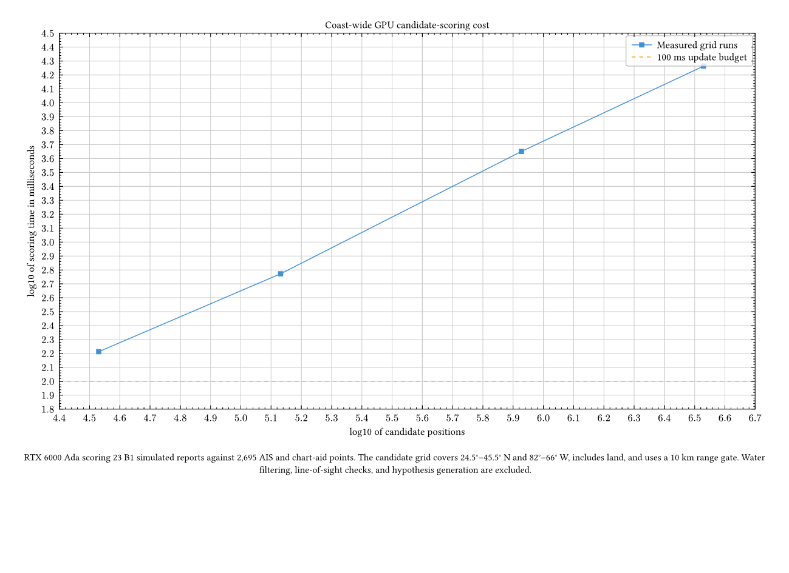

# Bearing-only maritime localization

This repository is a reproducible simulation study for locating a vessel from globally referenced object bearings and a catalog of AIS coordinates. Bearings are measured clockwise from north. The estimator receives object types when enabled, but it does not receive object identities, ranges, non-AIS coordinates, or the vessel's position.

The simulator reports objects inside a configurable visibility radius, including detections that have no AIS match. Reports contain global bearing and an optional type label, but no object identity, range, or observer pose. The initial sensor model uses Gaussian bearing error and can merge objects whose bearings fall within the configured angular resolution. When a map is supplied, water masks constrain observer placement and search candidates, while line-of-sight checks remove objects hidden by land. These map features are implemented, but the checked-in synthetic baseline does not use a coastline or navigable-water dataset.

## Software architecture

The implementation keeps simulation, search, and evaluation as separate runnable programs. The simulator writes sensor measurements, an AIS snapshot, and evaluator-only truth to separate files. Search reads measurements, AIS, optional map inputs, and configuration; it cannot use truth. Evaluation reads truth only after search has produced an estimate. The shared Python package contains versioned contracts, deterministic JSON serialization, water-mask queries, vector and raster line-of-sight, and spatial queries. `main.py` provides an orchestration entry point, and the standalone commands can also be invoked independently.

The main software tree reads left to right from external ingestion and the `main.py` trunk through the simulator, search, and evaluation. It presents the intended full component decomposition. The shared Python library is an independent package, not a branch in this tree. Each box width follows its label length, while every box shares the same height and font size. No dataset or output folders appear in the software tree.


The [main-tree zoomable PDF](docs/figures/software-architecture.pdf) and editable [Typst source](docs/figures/software-architecture.typ) are also available.

The shared library is shown separately. Its diagram follows the current package structure, with versioned contracts and geospatial modules imported by the programs that need them.


The [shared-library zoomable PDF](docs/figures/shared-library-architecture.pdf) and editable [Typst source](docs/figures/shared-library-architecture.typ) are also available.

## What a range limit changes

The maximum visibility range filters which AIS records can match an observation at each candidate vessel location. It does **not** limit the measured bearing angles, which still span 360°. With an infinite visibility range, distant AIS records remain eligible and compete in data association. The diagram shows the distinction.


## Initial benchmark

The checked-in baseline runs ten seeded trials with 350 random objects in a 40 km square, 70% AIS availability, and 0.5° bearing noise. It compares a 1 km position grid with and without multi-start refinement, with type labels enabled and disabled. Each run is evaluated at 10 km, 5 km, and 1 km visibility. The full configuration, trial CSV, summaries, and rerun script are under [`results/synthetic-baseline-v0.1.0/`](results/synthetic-baseline-v0.1.0/).


At 10 km visibility, type-aware refined grid search had a 50% fix rate and 154 ms median search time. At 5 km it had a 70% fix rate and 84 ms median search time. None of the tested settings achieved the 95% success target. The 1 km scenes had too few detections to estimate a position. The figure and detailed results show why median error alone is insufficient.

The example below is the largest-error full-feature trial at 10 km. The estimator selected 35 AIS associations, but none matched the true observed vessels; its estimated position was 22.53 km from the simulated observer. This is a deliberately visible failure case from the seeded benchmark.


These results are an initial software baseline, not a real-waterway performance claim. Ten trials do not establish operational reliability. The current search is not yet accurate or fast enough for the coast-wide 10 FPS objective.

## Install and run

Install [uv](https://docs.astral.sh/uv/), then run:

```sh
uv sync
uv run bearing-localization
```

The command runs the original synthetic baseline and writes trial summaries and backend timing data to `results/`. Separate commands are available for each program:

```sh
uv run bearing-simulator --help
uv run bearing-localization-search --help
uv run bearing-localization-evaluate --help
uv run bearing-benchmark --help
```

The simulator accepts separate measurement and truth output paths; AIS is also serialized separately for search. The benchmark command compares grid, randomized-hypothesis, and hierarchical search across visibility ranges and type-label settings. Its CPU/GPU backend profile measures the optional CuPy angular-residual kernel, including transfer time, but does not represent an end-to-end GPU localization benchmark.

To reproduce the checked-in results and explanatory figures, run:

```sh
sh tools/run_release_benchmark.sh
```

The benchmark takes approximately half a minute on the development machine. It requires Typst to compile the Typst figure sources. The PNG and PDF outputs are committed under `docs/figures/`; the editable sources use CeTZ or Lilaq.

Run the automated checks with `uv run pytest`, `uv run ruff format --check .`, `uv run ruff check .`, and `uv run ty check .`. The continuous-integration workflow also builds the package and compiles the figures.

## Major-port zoom maps

The multi-page [East Coast port map PDF](docs/figures/east-coast-port-zooms.pdf) gives each of the 24 observer sites its own 30 km view. Each page shows the selected water-cell center, the local shoreline, AIS vessels grouped by type, and NOAA ENC chart aids grouped by aid type. The AIS layer is the July 15, 2023 snapshot; the source data and prepared map windows are included in the repository.



The editable [Typst source](figures/east-coast-port-zooms.typ) draws the pages from the prepared data. Regenerate the local windows with `uv run python tools/prepare_port_zoom_data.py`, then compile the PDF with `typst compile --root . figures/east-coast-port-zooms.typ docs/figures/east-coast-port-zooms.pdf`.

## B1–B5 AIS-layout pilot

The first location-specific run uses five water sites, a July 2023 Chesapeake AIS snapshot, charted aids to navigation, and a 10 km visibility limit. The simulator generates synthetic global bearings with 0.5° Gaussian noise and applies land occlusion. The search region is 114 × 333 km. Three paired noise seeds were run per site with AIS type labels enabled and disabled.


At the 250 m and three-correct-association success rule, type-aware hierarchical search succeeded in 3 of 15 cases, all at B1. Grid and randomized search had no successful cases. Median errors across the 15 cases were 51.3 km for grid, 85.8 km for randomized, and 18.1 km for hierarchical search. Median search times were 1,187 ms, 37 ms, and 1,035 ms respectively. Without type labels, all three methods had zero successes. These timings exceed the 100 ms budget for 10 frames per second. Randomized search is fastest in this comparison, but its median location error is high and its runtime becomes comparable to the exhaustive methods when observations are too few for meaningful hypotheses.

B1 through B5 had 8, 3, 1, 1, and 9 visible AIS bearings at 10 km. The results show that sparse observations hurt recovery, but feature count alone does not explain accuracy: B5 had nine AIS bearings and still missed the 250 m threshold. The three-seed pilot cannot establish a general minimum feature count. Detailed per-trial results, coordinates, aggregate summaries, and assumptions are in [`results/ais-b1-b5-pilot-v1/`](results/ais-b1-b5-pilot-v1/). The figure source is [`figures/b1-b5-search-accuracy.typ`](figures/b1-b5-search-accuracy.typ).

The next figure zooms in on B1 and B5 for the first paired 10 km trial. Each panel is centered on the true boat location so the nearby grid and hierarchical estimates are easy to compare. Randomized estimates fall far outside the ±2 km panels. Exact projected positions and offsets are in [`b1-b5-estimate-positions.csv`](results/ais-b1-b5-pilot-v1/b1-b5-estimate-positions.csv).


The vessel layout and chart features are real, while the observer bearings are simulated. The 500 m land/water mask was classified from a rendered electronic chart and is approximate. The exact selected AIS vessel records, chart-aid coordinates, B1–B5 sites, and mask used in these experiments are now committed under [`data/`](data/), with source manifests and checksums. The full national AIS archive is not committed.

A follow-up adds known NOAA chart-aid coordinates to the search catalog while keeping the same simulated bearings. Hierarchical search then reached a 51.8 m median error with 9/15 successes. A 250 m exhaustive grid reached 81 m at B1 and 65 m at B5, but took about 43 seconds per search. The per-seed results and assumptions are in [`results/ais-b1-b5-pilot-v1/with-chart-aids/`](results/ais-b1-b5-pilot-v1/with-chart-aids/).

### Pairwise geometric hypotheses

The next search method intersects pairs of bearing rays with pairs of candidate AIS or chart-aid coordinates, then scores the resulting positions using the complete observation set. It rejects negative and out-of-range intersections, land candidates, and line-of-sight-blocked matches. On the 12 matched B1, B2, B4, and B5 trials where both methods returned estimates, pairwise search had 25.9 m median position error and 782 ms median latency, compared with 49.0 m and 2,000 ms for hierarchical search. Both methods met the full benchmark in 9/12 matched trials. Across all 15 attempts, both methods recorded 9 successes; pairwise search correctly returned no estimate for B3 because its simulated observation contained only one bearing. B4 estimates are typically within 50 m, but only one AIS vessel is visible, so the site does not meet the requirement for three correct AIS matches.



The [zoomable PDF](docs/figures/pairwise-search-comparison.pdf), [Typst source](figures/pairwise-search-comparison.typ), paired trial file, per-site summary, matched-case summary, and full configuration are in [`results/ais-b1-b5-pilot-v2-pairwise/`](results/ais-b1-b5-pilot-v2-pairwise/). Reproduce the trial data with `uv run python tools/run_ais_enc_pilot.py --replicates 3`.

### GPU scoring feasibility

On `comech-2080`, a GPU benchmark evaluated many independent candidate-to-object bearing scores. For 32,768 candidates, 800 catalog objects, and 10 observations, the RTX 6000 Ada took 10.8–17.5 ms end to end, versus 2.1–2.35 s for a chunked NumPy baseline. CPU and GPU selected the same best candidate in all 12 tested cases, with maximum score differences below 0.0004°. This isolates score evaluation; it does not include hypothesis generation, map visibility, or full search orchestration, so it does not demonstrate 10 FPS end to end. The script and raw results are in [`results/ais-b1-b5-pilot-v2-pairwise/gpu-benchmark.md`](results/ais-b1-b5-pilot-v2-pairwise/gpu-benchmark.md).

### Eastern Seaboard scale

The initial GPU scaling run used 2,268 AIS positions from the same July 2023 minute across a Florida-to-Maine bounding box, plus only 427 Chesapeake chart aids and 23 simulated B1 reports. Exhaustive scoring took 163 ms for 33,901 candidates at 10 km grid spacing and 18.3 s for 3.38 million candidates at 1 km spacing. It excluded water filtering, land ray checks, one-to-one assignment, and pairwise hypothesis generation, so it measured candidate scoring rather than a complete coast-wide localization run. The next section replaces the Chesapeake-only aid catalog with NOAA ENC aids across the full East Coast bounds.



The [scaling results and configuration](results/eastern-seaboard-gpu/) include repeated timings and exact counts. The complete one-minute AIS snapshot is committed under [`data/ais/`](data/ais/), and the run is reproducible with [`tools/benchmark_eastern_seaboard_gpu.py`](tools/benchmark_eastern_seaboard_gpu.py).

## Next validation stage

Historical AIS broadcasts can provide realistic vessel layouts for selected dates and coastal regions. The committed one-minute samples contain 372 Chesapeake vessels and 2,268 AIS positions across the Eastern Seaboard from NOAA's July 15, 2023 daily archive; the full national archive remains external. The selected rows and processing metadata are under [`data/ais/`](data/ais/). The extraction workflow is in [`tools/extract_ais_snapshot.py`](tools/extract_ais_snapshot.py), and processing details are in [`docs/experiment-design.md`](docs/experiment-design.md).

This pilot supplies a real vessel layout and NOAA ENC chart-aid coordinates, but it is not a real visual-observation dataset. The current experiment projects the positions into a local metric frame, uses fixed water-only B1–B5 observer locations, and generates synthetic global-bearing observations. Broader spatial coverage, a higher-resolution authoritative shoreline mask, and measured visual detections remain future validation stages.

For coast-wide scale, exhaustive position-grid work grows with map area divided by grid-cell area, then incurs assignment cost at every candidate. The new East Coast comparison includes grid, hierarchical, randomized, and range-pruned pairwise search. It remains an unmasked rectangular-domain diagnostic and is not a coast-ready accuracy or 10 FPS result; a coast-wide water/land mask and a coast-appropriate projection are required for the next validation.

### East Coast chart-aid coverage and search comparison

The new [NOAA ENC aid catalog](data/chart-aids/eastern-seaboard-enc-aids.csv) contains 64,400 point-feature rows inside longitude −82° to −66° and latitude 24.5° to 45.5°. It includes all six ENC scale bands and preserves the source layer, chart cell, object class, and available S-57 attributes. The [manifest](data/chart-aids/eastern-seaboard-enc-aids.manifest.json) records band counts, retrieval time, bounding box, and SHA-256. NOAA notes that merging multiple scale bands can duplicate features and recommends selecting one scale band for a scale-specific extraction. The search benchmark therefore compares a deduplicated all-band catalog of 51,416 class/location entries with an Approach-only catalog of 11,248 entries. See [NOAA ENC Direct to GIS](https://nauticalcharts.noaa.gov/learn/encdirect/) for the data model and scale-band guidance.

The [search benchmark](tools/benchmark_eastern_seaboard_search.py) uses the seeded 23-bearing B1 simulation, but searches across the full East Coast rectangle with the 2,268-position AIS snapshot and the full chart-aid catalog. The reproducible rerun does not support the earlier 20 m pairwise result; that result changed with catalog ordering and has been removed. With the all-band deduplicated catalog and type labels enabled, hierarchical search was closest at 4.08 km error in 395 ms, while grid search was 272.8 km off in 416 ms, randomized search was 25.8 km off in 2,470 ms, pairwise search was 593.9 km off in 26,335 ms, and global-then-local hierarchical search was 6.85 km off in 583 ms. No method recovered three correct AIS matches, so none met the benchmark success criterion. The paired results for all five methods, both type-label modes, and both catalogs are in [`results/eastern-seaboard-search/algorithm-comparison.csv`](results/eastern-seaboard-search/algorithm-comparison.csv), with methodology and limitations in the [result notes](results/eastern-seaboard-search/README.md).

These figures are a controlled algorithm diagnostic, not a validated coast-wide localization benchmark. The simulated observer is still at B1 in Chesapeake, the search rectangle includes land, no land line-of-sight mask is applied during search, the report geometry uses a local Chesapeake projection, and the coast-wide chart-aid catalog was retrieved in 2026 while AIS is from 2023. The pairwise method avoids allocating all catalog object pairs by limiting target-pair generation to objects within twice the 10 km visibility range, but its sampled hypotheses currently produce poor estimates and take 17–30 seconds. The two-stage hierarchical experiment first searches globally, then trims the catalog and search box around the coarse estimate; it does not yet improve accuracy. Coast-wide water constraints, a coast-appropriate projection, stronger candidate ranking, and validated GPU end-to-end runs remain next steps.

## Citation and reuse

The repository includes `CITATION.cff` for software citation. No software license has been selected yet, so the source is publicly viewable but is not currently granted an open-source reuse license. Choose and add a license before redistributing or incorporating the code into another project.
