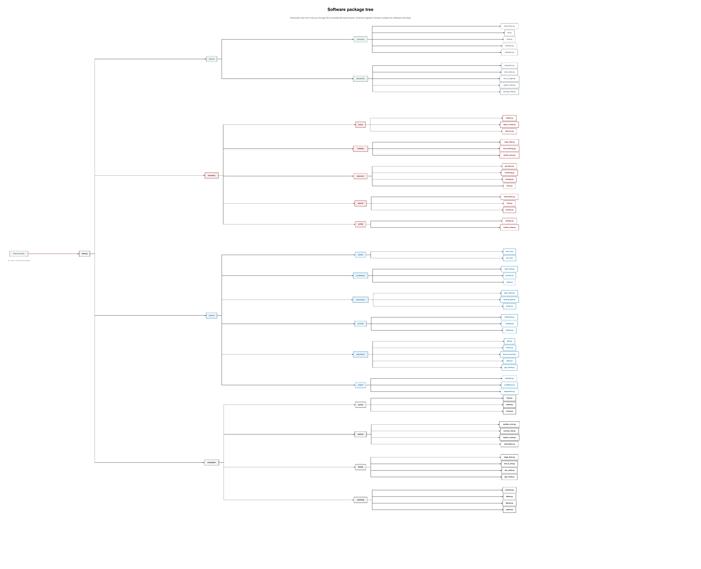
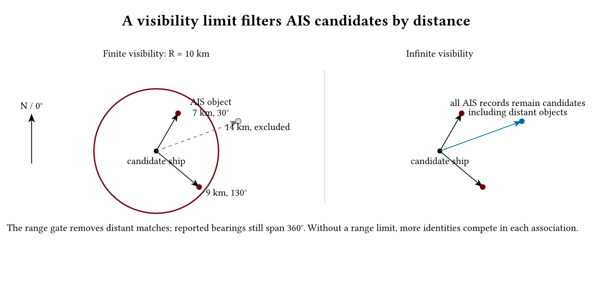
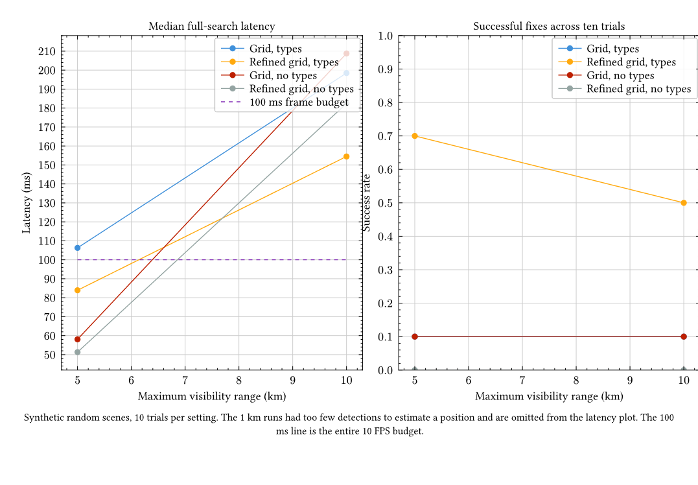
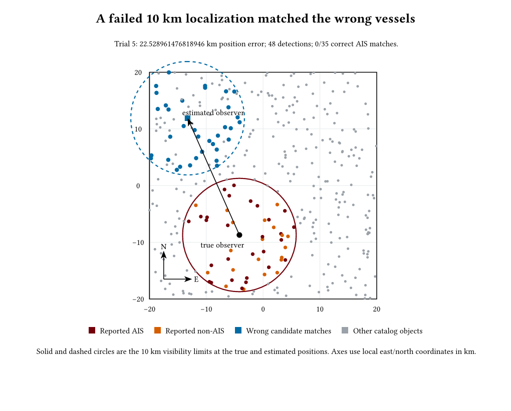
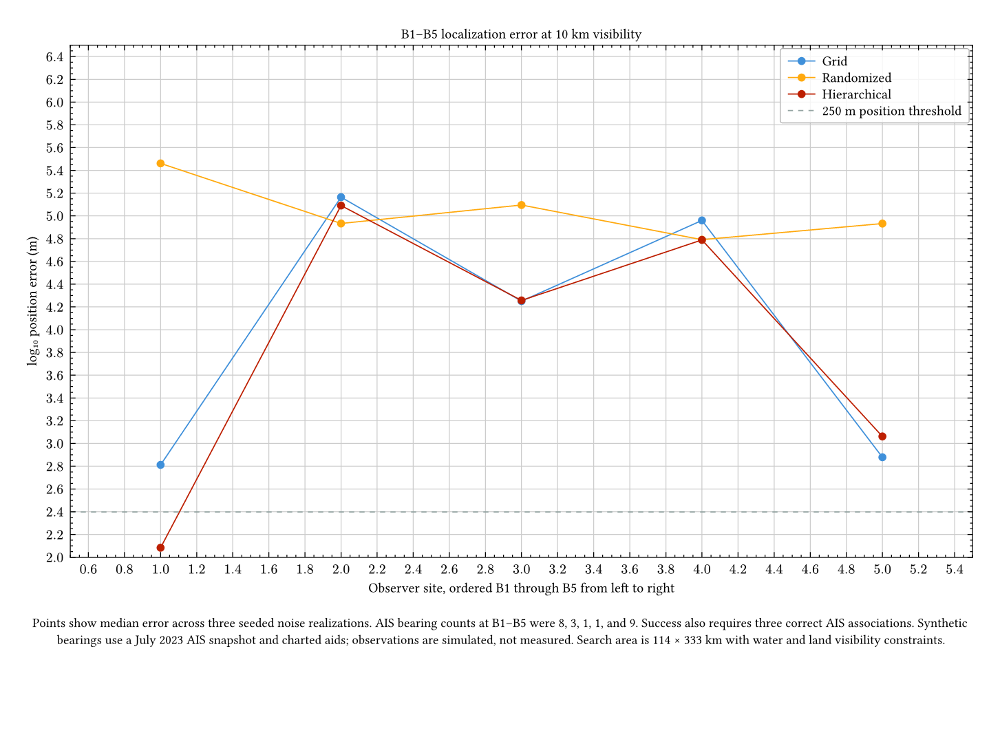
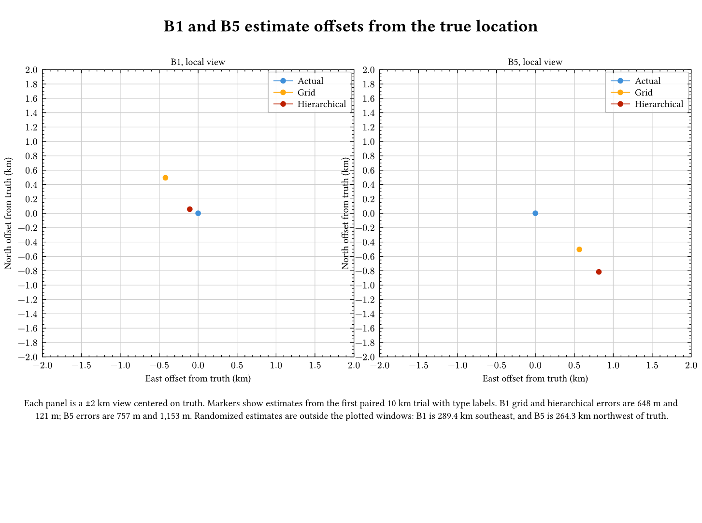

# Bearing-only maritime localization

This repository is a reproducible simulation study for locating a vessel from globally referenced object bearings and a catalog of AIS coordinates. Bearings are measured clockwise from north. The estimator receives object types when enabled, but it does not receive object identities, ranges, non-AIS coordinates, or the vessel's position.

The simulator reports objects inside a configurable visibility radius, including detections that have no AIS match. Reports contain global bearing and an optional type label, but no object identity, range, or observer pose. The initial sensor model uses Gaussian bearing error and can merge objects whose bearings fall within the configured angular resolution. When a map is supplied, water masks constrain observer placement and search candidates, while line-of-sight checks remove objects hidden by land. These map features are implemented, but the checked-in synthetic baseline does not use a coastline or navigable-water dataset.

## Software architecture

The implementation keeps simulation, search, and evaluation as separate runnable programs. The simulator writes sensor measurements, an AIS snapshot, and evaluator-only truth to separate files. Search reads measurements, AIS, optional map inputs, and configuration; it cannot use truth. Evaluation reads truth only after search has produced an estimate. The shared Python package contains versioned contracts, deterministic JSON serialization, water-mask queries, vector and raster line-of-sight, and spatial queries. `main.py` provides an orchestration entry point, and the standalone commands can also be invoked independently.

The main software tree reads left to right from external ingestion and the `main.py` trunk through the simulator, search, and evaluation. It presents the intended full component decomposition. The shared Python library is an independent package, not a branch in this tree. Each box width follows its label length, while every box shares the same height and font size. No dataset or output folders appear in the software tree.



The [main-tree zoomable PDF](docs/figures/software-architecture.pdf) and editable [Typst source](docs/figures/software-architecture.typ) are also available.

The shared library is shown separately. Its diagram follows the current package structure, with versioned contracts and geospatial modules imported by the programs that need them.


The [shared-library zoomable PDF](docs/figures/shared-library-architecture.pdf) and editable [Typst source](docs/figures/shared-library-architecture.typ) are also available.

## What a range limit changes

The maximum visibility range filters which AIS records can match an observation at each candidate vessel location. It does **not** limit the measured bearing angles, which still span 360°. With an infinite visibility range, distant AIS records remain eligible and compete in data association. The diagram shows the distinction.



## Initial benchmark

The checked-in baseline runs ten seeded trials with 350 random objects in a 40 km square, 70% AIS availability, and 0.5° bearing noise. It compares a 1 km position grid with and without multi-start refinement, with type labels enabled and disabled. Each run is evaluated at 10 km, 5 km, and 1 km visibility. The full configuration, trial CSV, summaries, and rerun script are under [`results/synthetic-baseline-v0.1.0/`](results/synthetic-baseline-v0.1.0/).



At 10 km visibility, type-aware refined grid search had a 50% fix rate and 154 ms median search time. At 5 km it had a 70% fix rate and 84 ms median search time. None of the tested settings achieved the 95% success target. The 1 km scenes had too few detections to estimate a position. The figure and detailed results show why median error alone is insufficient.

The example below is the largest-error full-feature trial at 10 km. The estimator selected 35 AIS associations, but none matched the true observed vessels; its estimated position was 22.53 km from the simulated observer. This is a deliberately visible failure case from the seeded benchmark.



These results are an initial software baseline, not a real-waterway performance claim. Ten trials do not establish operational reliability. The current search is not yet accurate or fast enough for the coast-wide 10 FPS objective.

## Install and run

Install [uv](https://docs.astral.sh/uv/), then run:

```sh
uv sync
uv run bearing-localization
```

The command runs the original synthetic baseline and writes trial summaries and backend timing data to `results/`. Separate commands are available for each program:

```sh
uv run bearing-simulator --help
uv run bearing-localization-search --help
uv run bearing-localization-evaluate --help
uv run bearing-benchmark --help
```

The simulator accepts separate measurement and truth output paths; AIS is also serialized separately for search. The benchmark command compares grid, randomized-hypothesis, and hierarchical search across visibility ranges and type-label settings. Its CPU/GPU backend profile measures the optional CuPy angular-residual kernel, including transfer time, but does not represent an end-to-end GPU localization benchmark.

To reproduce the checked-in results and explanatory figures, run:

```sh
sh tools/run_release_benchmark.sh
```

The benchmark takes approximately half a minute on the development machine. It requires Typst to compile the Typst figure sources. The PNG and PDF outputs are committed under `docs/figures/`; the editable sources use CeTZ or Lilaq.

Run the automated checks with `uv run pytest`, `uv run ruff format --check .`, `uv run ruff check .`, and `uv run ty check .`. The continuous-integration workflow also builds the package and compiles the figures.

## B1–B5 AIS-layout pilot

The first location-specific run uses five water sites, a July 2023 Chesapeake AIS snapshot, charted aids to navigation, and a 10 km visibility limit. The simulator generates synthetic global bearings with 0.5° Gaussian noise and applies land occlusion. The search region is 114 × 333 km. Three paired noise seeds were run per site with AIS type labels enabled and disabled.



At the 250 m and three-correct-association success rule, type-aware hierarchical search succeeded in 3 of 15 cases, all at B1. Grid and randomized search had no successful cases. Median errors across the 15 cases were 51.3 km for grid, 85.8 km for randomized, and 18.1 km for hierarchical search. Median search times were 1,187 ms, 37 ms, and 1,035 ms respectively. Without type labels, all three methods had zero successes. These timings exceed the 100 ms budget for 10 frames per second. Randomized search is fastest in this comparison, but its median location error is high and its runtime becomes comparable to the exhaustive methods when observations are too few for meaningful hypotheses.

B1 through B5 had 8, 3, 1, 1, and 9 visible AIS bearings at 10 km. The results show that sparse observations hurt recovery, but feature count alone does not explain accuracy: B5 had nine AIS bearings and still missed the 250 m threshold. The three-seed pilot cannot establish a general minimum feature count. Detailed per-trial results, coordinates, aggregate summaries, and assumptions are in [`results/ais-b1-b5-pilot-v1/`](results/ais-b1-b5-pilot-v1/). The figure source is [`figures/b1-b5-search-accuracy.typ`](figures/b1-b5-search-accuracy.typ).

The next figure zooms in on B1 and B5 for the first paired 10 km trial. Each panel is centered on the true boat location so the nearby grid and hierarchical estimates are easy to compare. Randomized estimates fall far outside the ±2 km panels. Exact projected positions and offsets are in [`b1-b5-estimate-positions.csv`](results/ais-b1-b5-pilot-v1/b1-b5-estimate-positions.csv).



The vessel layout and chart features are real, while the observer bearings are simulated. The 500 m land/water mask was classified from a rendered electronic chart and is approximate. Raw AIS rows and map imagery are not included in the repository.

A follow-up adds known NOAA chart-aid coordinates to the search catalog while keeping the same simulated bearings. Hierarchical search then reached a 51.8 m median error with 9/15 successes. A 250 m exhaustive grid reached 81 m at B1 and 65 m at B5, but took about 43 seconds per search. The per-seed results and assumptions are in [`results/ais-b1-b5-pilot-v1/with-chart-aids/`](results/ais-b1-b5-pilot-v1/with-chart-aids/).

## Next validation stage

Historical AIS broadcasts can provide realistic vessel layouts for selected dates and coastal regions. A first Chesapeake pilot has now been extracted from NOAA's July 15, 2023 daily archive. It contains 372 unique AIS vessels in a one-minute UTC window and demonstrates the bounded extraction workflow in [`tools/extract_ais_snapshot.py`](tools/extract_ais_snapshot.py). The full national archive and the extracted vessel records remain outside this repository while data-sharing terms are reviewed. The processing details and next steps are in [`docs/experiment-design.md`](docs/experiment-design.md).

This pilot supplies a real vessel layout, but it is not a real visual-observation dataset. The next integration step will convert positions to a local metric frame, sample hypothetical observers over navigable water, and generate global-bearing observations. NOAA Electronic Navigational Chart features will be needed to add buoys and other fixed aids to navigation.

For coast-wide scale, exhaustive position-grid work grows with map area divided by grid-cell area, then incurs assignment cost at every candidate. The next algorithm comparison should add sampled AIS-pair geometry, hierarchical search, and prior-guided local tracking. Ten frames per second allows 100 ms total per update; the current 10 km median search time already exceeds that budget.

## Citation and reuse

The repository includes `CITATION.cff` for software citation. No software license has been selected yet, so the source is publicly viewable but is not currently granted an open-source reuse license. Choose and add a license before redistributing or incorporating the code into another project.
