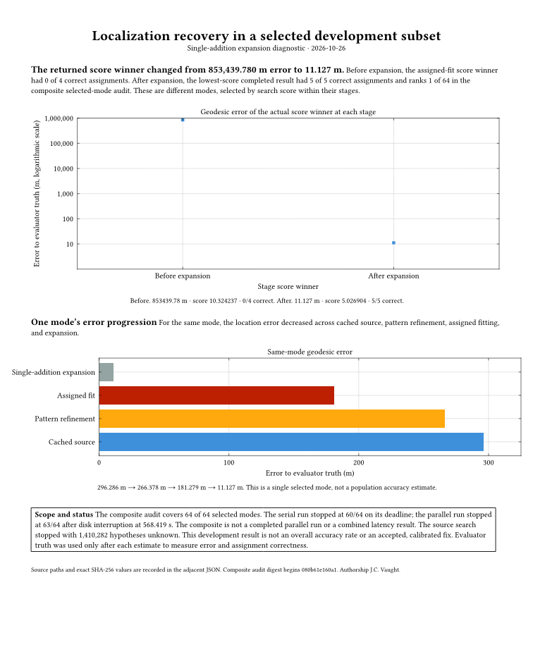
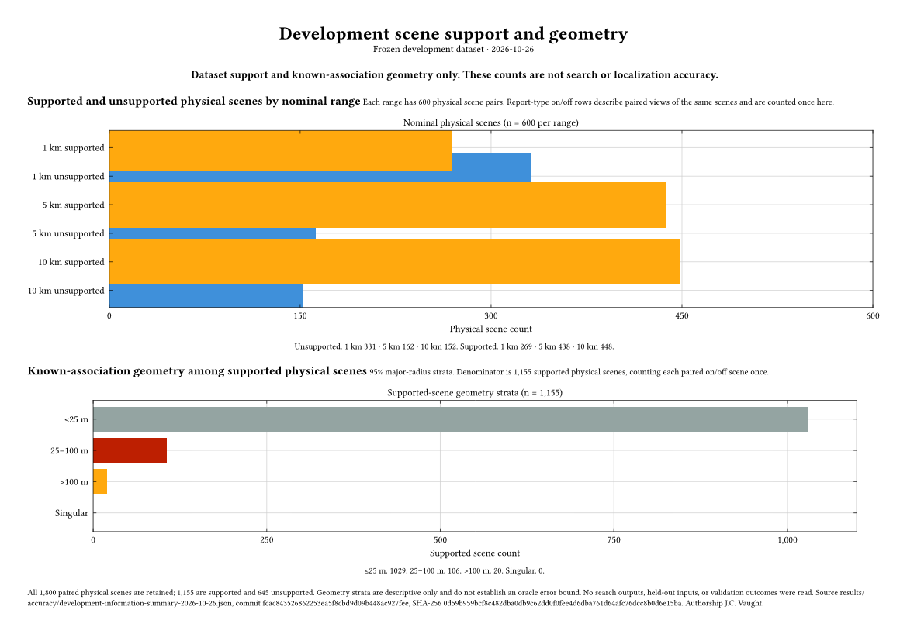

# Paused implementation handoff. 26 October 2026

J.C. Vaught.

## Pause state

Work is paused at the user's request for travel. The recurring implementation heartbeat is PAUSED. All active specialists saved and pushed their work, then stopped. The final owned server diagnostic completed naturally; no owned benchmark or worker remains active and the benchmark lock is free. Automated repository CI may finish unattended. No new benchmark or download is scheduled.

Main is the only branch. Historical specialist commits are preserved in main's ancestry through an archival merge that retains the consolidated implementation. The deleted branch-name to commit mapping is saved in branch-heads-before-single-main-2026-10-26.tsv; the earlier pause inventory remains available. Frozen execution worktrees and input paths remain in place because their hashes and paths are used by audit tools.

## Results and figures

The difficult development case now has an independently checked selected-mode recovery. The earlier score winner was 853,439.780 m from truth with zero correct associations among four assignments. Single-addition assignment expansion found a score winner 11.127 m from truth with five correct associations among five assignments. Its complete objective improved from 10.324237292 to 5.026904167. All 64 selected modes were covered by a deterministic composite of two interrupted runs, with canonical rescoring and branch evidence checks.

[Zoomable recovery PDF](figures/localization-recovery-summary-2026-10-26.pdf). [Detailed recovery PDF](figures/cached-refinement-progress-2026-10-26.pdf). [Independent composite audit](../reports/experiments/a35-cached-evaluation/parallel-composite-audit-report.md).

This is one development case with generated bearings over real catalog and chart geometry. It is not a calibrated accepted fix or a complete coast-wide result. The original coast-wide stream still has 1,410,282 unvisited candidate IDs. No population accuracy or 100 ms claim follows from the selected-mode recovery.

The next experiment starts assignment expansion directly from the original coarse hypotheses. It completed all 64 modes and all 24,419 planned branches with four workers in 990.358743 seconds, including 28.290069 seconds of setup/revalidation. The lowest returned objective is 5.026904160260579. The producer remains ambiguous and budget exhausted with no certificate because the entire coast-wide search is incomplete. Its new location error has not been independently evaluated. The raw output contains 48,902 durable events and is 29,702,921 bytes. The first attempt failed before dispatch on a ModeRow/dictionary interface mismatch; both attempts are retained.

[Direct-coarse experiment and raw artifacts](../reports/experiments/parallel-coarse-assignment-expansion/attempt-2/manifest.json). [Runner report](../reports/parallel-assignment-expansion-diagnostic.md).

The stronger-incumbent pruning comparison safely pruned 58 of 255 candidates and retained the exact best and ties over the candidate sample plus incumbent. It took 30.680 seconds versus 19.939 seconds for direct exact scoring. Independent post-prune verification added 2.853 seconds. This slower experiment remains disabled by default. [Pruning report](../reports/a22-pre-los-profile.md).

## Development population

All 3,600 nominal range/type rows have verified frozen support and difficulty files. Paired type-enabled and type-disabled rows share the same physical scene. Counting each pair once gives 600 physical scenes per range, with 269 supported at 1 km, 438 at 5 km, and 448 at 10 km. Among the 1,155 supported physical scenes across ranges, known-association major-radius strata contain 1,029 at most 25 m, 106 between 25 and 100 m, and 20 above 100 m. These describe geometry and do not change eligibility or predict achieved search accuracy.

[Zoomable scene coverage PDF](figures/development-scene-coverage-2026-10-26.pdf). [Data summary and provenance](../reports/development-information-summary.md).

## Software and validation

The preceding main checkpoint 52a29a6 passed 1,186 tests with 32 optional skips in CI, plus Ruff formatting/lint, ty, builds, installed commands, and all Typst figure builds. The preceding release to main passed 1,171 tests. These are software checks, not accuracy acceptance results; the optional GPU CI jobs did not run.

The final pause batch passed full-project Ruff formatting/lint and ty, and 57 focused tests across assignment expansion, optional timing, coarse-runner behavior, coarse evaluation fixtures, and pre-line-of-sight screening. The prior pruning/runner integration passed 49 focused tests. Full CI for the pause batch is allowed to finish unattended and is not described as passed at handoff.

The optional stage timer is integrated with its default disabled. It measures pool preparation, seed validation, frozen-target preparation, solver fit, nested residual work, canonical scoring, callbacks, and uninstrumented remainder. No stage-profile benchmark was run. Nested residual time must not be added to solver-fit time.

## Incomplete work saved on main

The direct-coarse evaluator is an experimental checkpoint. Its pre-truth gate encountered tuple-versus-list serialization differences; JSON normalization is saved, but the real artifact gate was not rerun before pause. Twelve evaluator fixtures passed. Before using it to publish accuracy, add immutable producer-source verification, completed/budget/counter consistency, and proof that each returned best hypothesis comes from its seed or a retained branch result. Then rerun structural checks and exact canonical rescoring with the frozen scorer bootstrap. No truth was read for the new coarse-run evaluation.

The primary remaining implementation task is reducing complete-search work without discarding valid regions or changing the objective. The direct-coarse experiment removes dependence on two earlier refinement stages, but the current full search remains incomplete and slow. Profile the saved expensive branch before selecting the next optimization. Any GPU proposal or score acceleration must retain CPU FP64 authority and pass parity checks.

Calibration, the six separate accuracy/availability decisions, held-out execution, clean one/two/four-GPU timings, the final independent release review, and measured-bearing field validation remain unfinished. The required 90 percent availability and 95 percent accepted-fix accuracy within 100 m have not been declared passed. Frozen splits, eligibility, objective, and thresholds remain unchanged.

## Storage and restart

The active project remains on comech-2080 at /home/jvaught2/projects/bearing-only-maritime-localization. Inactive archives are verified on comech-1176 at /home/jvaught/projects/bearing-only-maritime-localization-archive. Removing 36 verified inactive worktrees increased measured free space by 6,660,120,576 bytes. An orphan environment and three build trees were also archived. Active datasets, frozen worktrees and references were preserved. About 49.6 GB remained free at diagnostic completion, above the 40 GiB reserve.

[Storage manifests and restoration record](storage-audit-worktree-removal-2026-10-26.md). [Full chronological progress](accuracy-progress-2026-10-26.md). [Implementation ledger](accuracy-implementation-ledger.md).

When the user returns, inspect main and this report before starting agents. Confirm CI outcomes and disk reserve, finish the direct-coarse audit, then profile selected-mode costs and resume the full-domain plan. Keep the heartbeat paused until the user asks to resume. Do not rerun held-out work or alter frozen manifests to compensate for a failed result.

## Single-branch cleanup

The user requested one branch after the pause. All remote and local branch tips were inventoried and preserved as ancestors of main before branch-name deletion. The archival merge deliberately preserves the current consolidated source tree. Only this handoff and the branch inventory change. Frozen worktrees retain their original commits as detached checkouts, with their files preserved. The implementation and recurring continuation remain paused.
