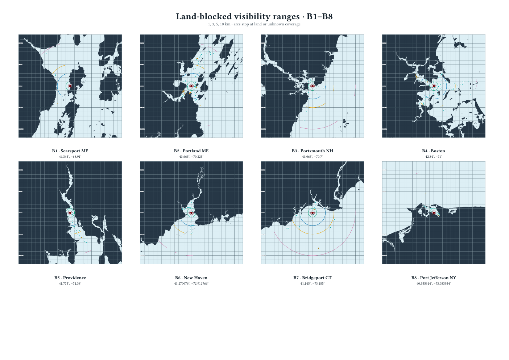
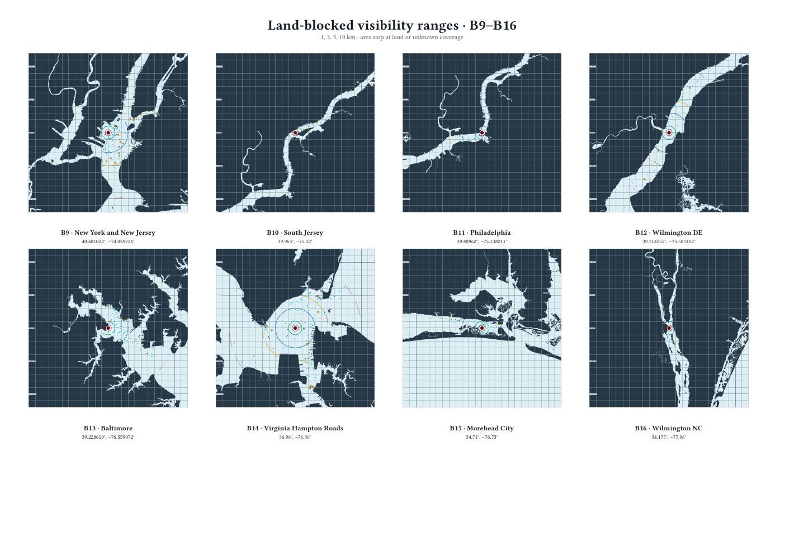
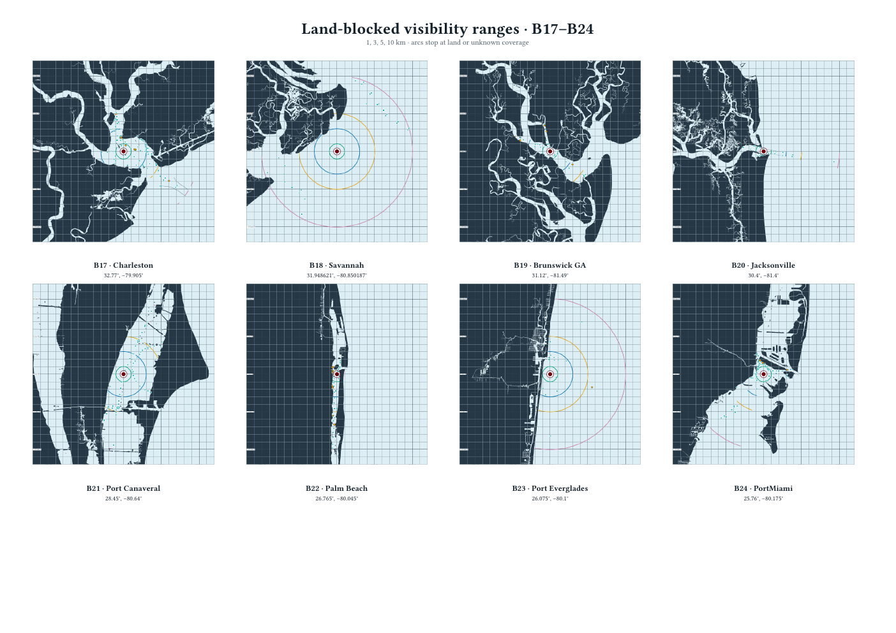

# Land-blocked B-point visibility ranges

The maps show 1, 3, 5, and 10 km visibility ranges for the 24 observer locations. Range arcs follow the simulator line-of-sight rule and stop at mapped land or unknown coverage. AIS and chart-aid markers appear only when line of sight is clear. Each detailed map has a 1 km projected grid.

The [full-resolution 24-page map set](figures/b-point-visibility-ranges.pdf) contains one map per observer.

## B1–B8

## B9–B16

## B17–B24

